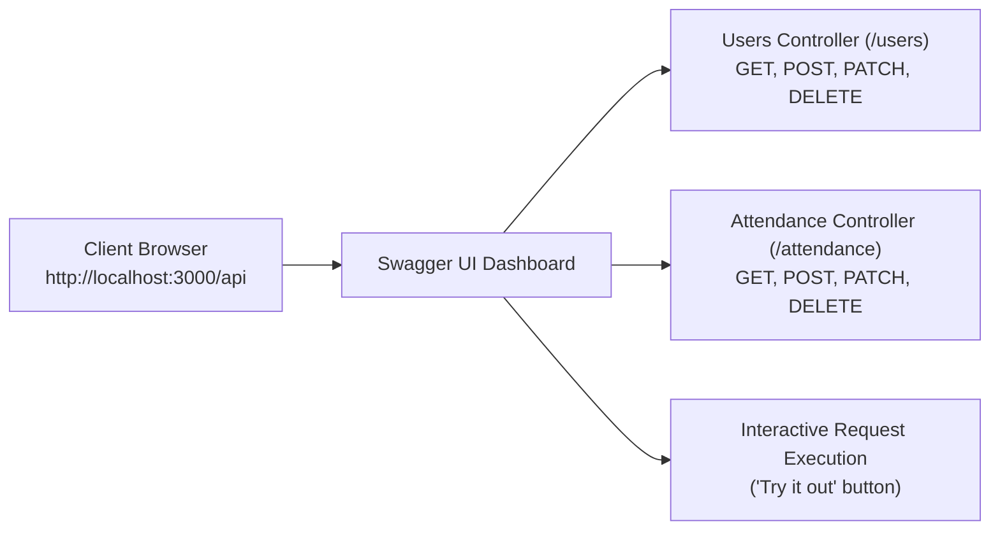

# How to View and Test All API Routes in NestJS
## Complete Route Directory & Swagger / OpenAPI Setup Guide

This guide provides:
1. **The Complete Route Directory** of all active endpoints in this application.
2. **How to View Routes Interactively via Swagger UI** (`http://localhost:3000/api`).
3. **How to View Routes via the Terminal / Console**.
4. **How to Enhance Routes with OpenAPI Decorators** for production-grade documentation.

---

## 1. Complete Active API Route Directory

All routes currently available in [`TKPEX`](file:///d:/Dev/TKPEX) (running on `http://localhost:3000`):

### Users Endpoints (`/users`)

| Method | URL | Description | Request Body (DTO) | Response |
| :--- | :--- | :--- | :--- | :--- |
| `GET` | `/users` | Get all registered users | *None* | `UserResponseDto[]` |
| `GET` | `/users/:id` | Get single user by UUID | *None* | `UserResponseDto` |
| `POST` | `/users` | Register a new user | [`CreateUserDto`](file:///d:/Dev/TKPEX/src/modules/users/dto/create-user.dto.ts) (`name`, `email`, `password`, `role`) | `UserResponseDto` (201 Created) |
| `PATCH` | `/users/:id` | Update user details | [`UpdateUserDto`](file:///d:/Dev/TKPEX/src/modules/users/dto/update-user.dto.ts) (`name`, `email`, `role`) | `UserResponseDto` |
| `DELETE` | `/users/:id` | Delete a user | *None* | `{ message: "..." }` |

---

### Attendance Endpoints (`/attendance`)

| Method | URL | Description | Query / Body Params | Response |
| :--- | :--- | :--- | :--- | :--- |
| `GET` | `/attendance` | List attendance logs | Query: `?userId=<id>&date=YYYY-MM-DD` | `AttendanceResponseDto[]` |
| `GET` | `/attendance/summary` | Get status counts summary | Query: `?userId=<id>` | `{ total, present, late, absent... }` |
| `GET` | `/attendance/:id` | Get single attendance log | *None* | `AttendanceResponseDto` |
| `POST` | `/attendance/check-in` | Clock-in today | [`CheckInDto`](file:///d:/Dev/TKPEX/src/modules/attendance/dto/check-in.dto.ts) (`userId`, `notes`) | `AttendanceResponseDto` (201 Created) |
| `POST` | `/attendance/:id/check-out` | Clock-out | [`CheckOutDto`](file:///d:/Dev/TKPEX/src/modules/attendance/dto/check-out.dto.ts) (`notes`) | `AttendanceResponseDto` |
| `POST` | `/attendance` | Manual admin entry | [`CreateAttendanceDto`](file:///d:/Dev/TKPEX/src/modules/attendance/dto/create-attendance.dto.ts) | `AttendanceResponseDto` (201 Created) |
| `PATCH` | `/attendance/:id` | Update attendance log | [`UpdateAttendanceDto`](file:///d:/Dev/TKPEX/src/modules/attendance/dto/update-attendance.dto.ts) | `AttendanceResponseDto` |
| `DELETE` | `/attendance/:id` | Delete attendance log | *None* | `{ message: "..." }` |

---

### System / Root Endpoints (`/`)

| Method | URL | Description | Response |
| :--- | :--- | :--- | :--- |
| `GET` | `/` | Health / Welcome check | `"Hello World!"` |

---

## 2. Option 1: View Routes via Swagger UI (Recommended)

**Swagger** is the industry standard for viewing and testing API routes. It generates an interactive documentation webpage where you can view every route and click **"Try it out"** to send requests directly from your browser.



### Installation Steps

#### Step 1: Install Swagger Package
Run this in your project terminal:
```powershell
pnpm add @nestjs/swagger
```

#### Step 2: Configure in [`src/main.ts`](file:///d:/Dev/TKPEX/src/main.ts)
Add the Swagger setup block before `app.listen(3000)`:

```typescript
import { DocumentBuilder, SwaggerModule } from '@nestjs/swagger';

async function bootstrap() {
  const app = await NestFactory.create(AppModule);

  // Global validation pipe
  app.useGlobalPipes(
    new ValidationPipe({
      whitelist: true,
      forbidNonWhitelisted: true,
      transform: true,
    }),
  );

  // 📄 Swagger Configuration
  const config = new DocumentBuilder()
    .setTitle('TKPEX REST API')
    .setDescription('Interactive API Documentation for Users, Attendance, and Schedules')
    .setVersion('1.0')
    .addTag('users', 'User account management & authentication')
    .addTag('attendance', 'Attendance tracking, check-ins, and shift records')
    .build();

  const documentFactory = () => SwaggerModule.createDocument(app, config);
  SwaggerModule.setup('api', app, documentFactory);

  await app.listen(3000);
  console.log('Swagger UI available at: http://localhost:3000/api');
}
bootstrap();
```

#### Step 3: Open in Browser
Restart the dev server (`pnpm run start:dev`) and visit:
```text
http://localhost:3000/api
```

---

## 3. Option 2: View Routes in the Terminal Console

When you launch `pnpm run start:dev`, NestJS's internal `RouterExplorer` automatically prints every mapped route to your console:

```text
[Nest] LOG [RoutesResolver] AppController {/}: +8ms
[Nest] LOG [RouterExplorer] Mapped {/, GET} route +2ms

[Nest] LOG [RoutesResolver] UsersController {/users}: +0ms
[Nest] LOG [RouterExplorer] Mapped {/users, GET} route +1ms
[Nest] LOG [RouterExplorer] Mapped {/users/:id, GET} route +1ms
[Nest] LOG [RouterExplorer] Mapped {/users, POST} route +0ms
[Nest] LOG [RouterExplorer] Mapped {/users/:id, PATCH} route +0ms
[Nest] LOG [RouterExplorer] Mapped {/users/:id, DELETE} route +0ms

[Nest] LOG [RoutesResolver] AttendanceController {/attendance}: +0ms
[Nest] LOG [RouterExplorer] Mapped {/attendance, GET} route +1ms
[Nest] LOG [RouterExplorer] Mapped {/attendance/summary, GET} route +0ms
[Nest] LOG [RouterExplorer] Mapped {/attendance/:id, GET} route +0ms
[Nest] LOG [RouterExplorer] Mapped {/attendance/check-in, POST} route +1ms
[Nest] LOG [RouterExplorer] Mapped {/attendance/:id/check-out, POST} route +0ms
[Nest] LOG [RouterExplorer] Mapped {/attendance, POST} route +0ms
[Nest] LOG [RouterExplorer] Mapped {/attendance/:id, PATCH} route +0ms
[Nest] LOG [RouterExplorer] Mapped {/attendance/:id, DELETE} route +0ms
```

---

## 4. How to Decorate DTOs for Beautiful Swagger Docs

To display example payloads and descriptions inside Swagger UI, add `@ApiProperty()` to your DTOs:

```typescript
import { ApiProperty, ApiPropertyOptional } from '@nestjs/swagger';
import { IsEmail, IsNotEmpty, IsString, MinLength } from 'class-validator';

export class CreateUserDto {
  @ApiProperty({ example: 'John Doe', description: 'Full name of the user' })
  @IsString()
  @IsNotEmpty()
  name: string;

  @ApiProperty({ example: 'john@example.com', description: 'Unique email address' })
  @IsEmail()
  email: string;

  @ApiProperty({ example: 'password123', description: 'Password (min 6 characters)' })
  @IsString()
  @MinLength(6)
  password: string;

  @ApiPropertyOptional({ example: 'user', enum: ['admin', 'user'] })
  role?: 'admin' | 'user';
}
```

---

## 5. Quick Testing with PowerShell

If you don't have Swagger open yet, you can test any route directly from your terminal:

```powershell
# 1. View all users
Invoke-RestMethod -Uri http://localhost:3000/users -Method Get | ConvertTo-Json

# 2. View attendance logs
Invoke-RestMethod -Uri http://localhost:3000/attendance -Method Get | ConvertTo-Json

# 3. View attendance summary statistics
Invoke-RestMethod -Uri http://localhost:3000/attendance/summary -Method Get | ConvertTo-Json
```
