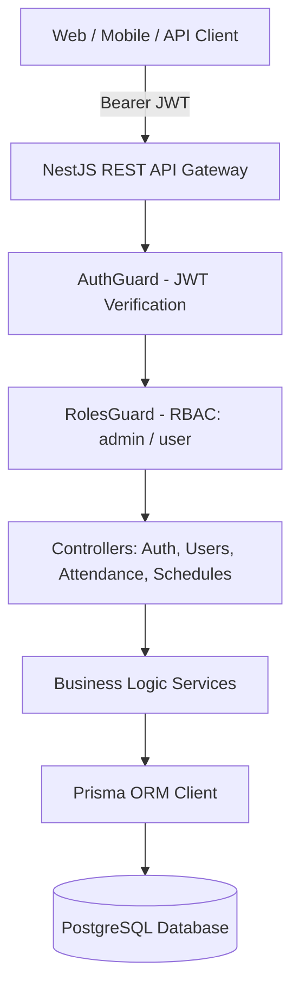
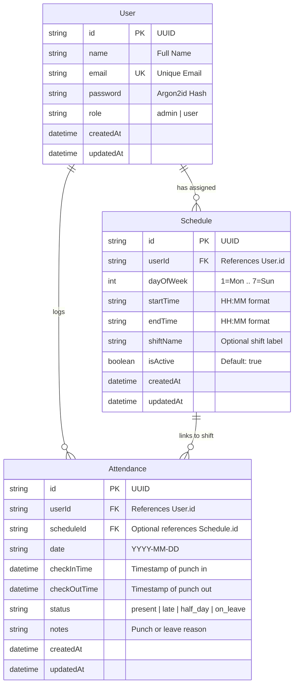
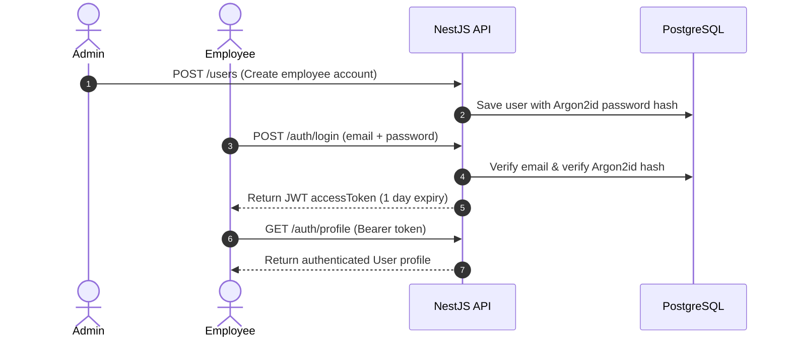
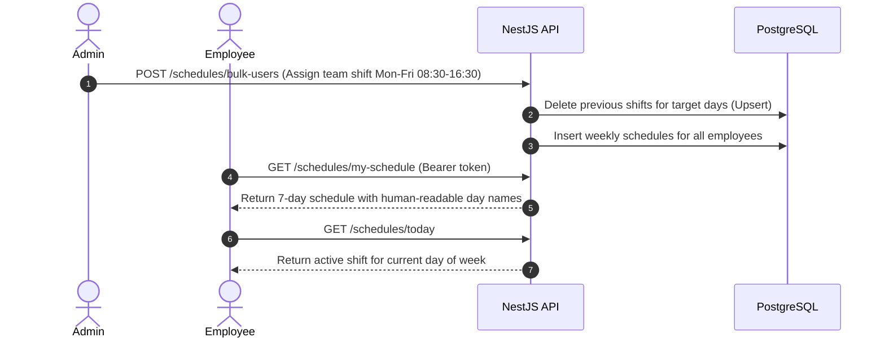
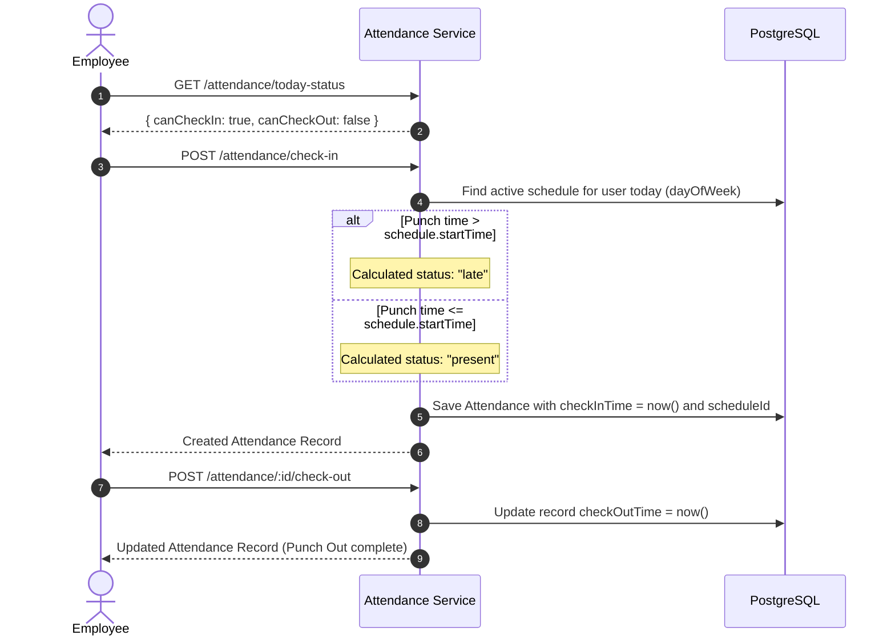
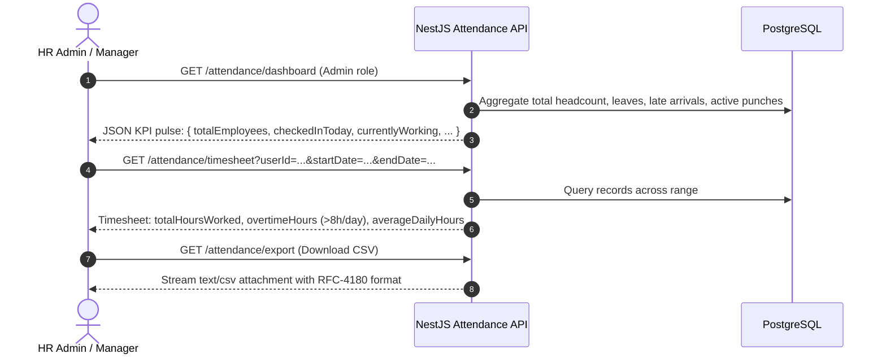

# TKPEX End-to-End System & Developer Guide

Welcome to the comprehensive, end-to-end architectural and operational guide for **TKPEX** — a high-performance, enterprise-grade Employee Attendance, Shift Scheduling, and HR Timesheet management system built on **NestJS 12**, **Prisma ORM**, and **PostgreSQL**.

---

## 1. System Architecture & Tech Stack



### Core Technologies
- **Runtime & Framework**: NestJS 12 with Node.js ECMAScript Modules (`"moduleResolution": "NodeNext"`). All local relative imports strictly use `.js` extensions.
- **Database & ORM**: PostgreSQL with Prisma ORM client and automated migrations.
- **Cryptography & Security**: Argon2id for one-way salted password hashing, JWT (`@nestjs/jwt`) for stateless token issuance and verification.
- **Role-Based Access Control (RBAC)**: Centralized `@Roles('admin', 'user')` decorator and reflector-based `RolesGuard`.
- **Validation**: `class-validator` and `class-transformer` validating incoming DTO payloads with strict typing.
- **Test Suite**: Vitest for fast unit testing and Supertest for E2E testing.
- **Linter**: Oxlint for code quality and convention enforcement.

---

## 2. Database Schema & Data Modeling

The PostgreSQL schema consists of three interconnected models with cascade behaviors:



---

## 3. End-to-End Operational Lifecycle Flows

### Flow 1: Identity & Authentication Lifecycle


1. **User Creation**:
   - Admin provisions accounts via `POST /users` (or via `prisma/seed.js`).
   - Passwords are automatically hashed with Argon2id (`$argon2id$v=19$m=65536,t=3,p=4$...`).
2. **Login & Session Issuance**:
   - User submits email and password to `POST /auth/login`.
   - On success, receives a signed JWT access token containing `{ sub: userId, email, role }`.
3. **Self-Service Profile & Password Management**:
   - `GET /auth/profile`: Returns active user details.
   - `PATCH /auth/profile`: Update self name or email.
   - `POST /auth/change-password`: Self change password verifying old password.
   - `POST /auth/forgot-password` & `POST /auth/reset-password`: 15-minute reset token workflow.

---

### Flow 2: Shift Scheduling & Team Rosters


#### Assignment Methods:
1. **Single Day Assignment (`POST /schedules`)**:
   - Assigns a shift for a single day (`dayOfWeek: 1..7`).
   - Automatically **upserts**: if an active shift already exists on that day, it updates the hours rather than creating conflicting duplicates.
2. **Single User Bulk Recurring (`POST /schedules/bulk`)**:
   - Accepts `workDays: [1, 2, 3, 4, 5]` and assigns the full week to one user in a single transaction.
3. **Cohort / Multi-User Assignment (`POST /schedules/bulk-users`)**:
   - Accepts `userIds: ["uuid1", "uuid2"]` and `workDays: [1, 2, 3, 4, 5]` to roster entire teams or departments simultaneously.

---

### Flow 3: Attendance Punching & Dynamic Late Calculation


#### Core Business Rules for Attendance:
1. **Single Check-In Guard**: Employees can only punch in once per calendar date (`YYYY-MM-DD`). A second attempt throws `409 Conflict`.
2. **Dynamic Schedule-Aware Punctuality**:
   - Rather than relying on a static company-wide time, the system resolves the employee's active schedule for the day.
   - If scheduled at `08:00` and punching in at `08:15`, they are marked **`late`**.
   - If scheduled at `13:00` and punching in at `11:00`, they are marked **`present`**.
   - Falls back to `09:00 AM` only when no shift is assigned.
3. **Leave Applications (`POST /attendance/leave`)**:
   - Allows employees to apply for full vacation/medical leaves (`on_leave`) or half-days (`half_day`) without physical check-in punches.

---

### Flow 4: HR Dashboard, Analytics & Timesheet Reporting


#### Key Reporting Features:
- **HR Dashboard Pulse (`GET /attendance/dashboard`)**: Instant company overview showing:
  - `totalEmployees`: Total registered staff count.
  - `checkedInToday`: Total employees who arrived today.
  - `currentlyWorking`: Employees currently on-site (`checkOutTime IS NULL`).
  - `lateToday`: Late arrivals today.
  - `onLeaveToday`: Employees on approved leave.
  - `notPunchedYet`: Unaccounted employees.
- **Timesheet Calculator (`GET /attendance/timesheet`)**:
  - Automatically calculates net hours worked per day (`checkOutTime - checkInTime`).
  - Flags daily overtime for work exceeding 8.00 hours (480 minutes).
  - Computes average daily hours and attendance breakdown.
- **Payroll CSV Export (`GET /attendance/export`)**:
  - Emits formatted RFC-4180 CSV with headers: `Attendance ID, User ID, Employee Name, Email, Date, Check In Time, Check Out Time, Hours Worked, Status, Notes`.

---

## 4. Complete RBAC & Route Reference

| HTTP Method | Route Path | Access Level | Description |
| :--- | :--- | :--- | :--- |
| **AUTH MODULE** | | | |
| `POST` | `/auth/login` | Public | Authenticates credentials, returns JWT `accessToken`. |
| `GET` | `/auth/profile` | `user` & `admin` | Returns authenticated user identity. |
| `PATCH` | `/auth/profile` | `user` & `admin` | Updates self name or email address. |
| `POST` | `/auth/change-password` | `user` & `admin` | Changes self password verifying current password. |
| `POST` | `/auth/forgot-password` | Public | Generates 15-minute signed JWT password reset token. |
| `POST` | `/auth/reset-password` | Public | Validates reset token and sets new Argon2id password. |
| **USERS MODULE** | | | |
| `GET` | `/users` | `admin` | Lists all registered employees. |
| `GET` | `/users/:id` | `admin` | Fetches details of a specific user. |
| `POST` | `/users` | `admin` | Creates/provisions new employee account. |
| `PATCH` | `/users/:id` | `admin` | Modifies user details, role, or password. |
| `DELETE` | `/users/:id` | `admin` | Deletes user with cascade to linked attendances. |
| **SCHEDULES MODULE** | | | |
| `GET` | `/schedules/my-schedule`| `user` & `admin` | Returns 7-day schedule for the authenticated user. |
| `GET` | `/schedules/today` | `user` & `admin` | Returns active shift for today's day of the week. |
| `GET` | `/schedules` | `admin` (or own) | Lists shift schedules (filterable by `?userId=...`). |
| `GET` | `/schedules/:id` | `admin` (or own) | Retrieves single schedule by ID. |
| `POST` | `/schedules` | `admin` | Creates/upserts single-day shift for an employee. |
| `POST` | `/schedules/bulk` | `admin` | Bulk assigns multi-day shifts for one employee. |
| `POST` | `/schedules/bulk-users` | `admin` | Assigns weekly shifts to multiple employees at once. |
| `PATCH` | `/schedules/:id` | `admin` | Updates shift timings or active status. |
| `DELETE` | `/schedules/:id` | `admin` | Deletes schedule assignment. |
| **ATTENDANCE MODULE** | | | |
| `GET` | `/attendance/today-status`| `user` & `admin` | Checks today's punch state (`canCheckIn`, `canCheckOut`). |
| `GET` | `/attendance/currently-in`| `admin` | Lists employees currently working on-site today. |
| `GET` | `/attendance/dashboard` | `admin` | HR KPI pulse (headcount, late, leaves, active). |
| `GET` | `/attendance/timesheet` | `user` & `admin` | Calculates work hours, overtime, and day counts. |
| `GET` | `/attendance/export` | `user` & `admin` | Streams attendance records as downloadable `.csv`. |
| `GET` | `/attendance` | `user` & `admin` | Lists punch records (`user` filtered to self). |
| `GET` | `/attendance/summary` | `user` & `admin` | Summary stats count (`present`, `late`, `on_leave`). |
| `GET` | `/attendance/:id` | `user` & `admin` | Inspects single attendance record by ID. |
| `POST` | `/attendance/check-in` | `user` & `admin` | Punches in for the day (dynamic late calculation). |
| `POST` | `/attendance/leave` | `user` & `admin` | Submits leave or half-day application. |
| `POST` | `/attendance/:id/check-out`| `user` & `admin` | Punches out for the day (sets `checkOutTime`). |
| `POST` | `/attendance` | `admin` | Manually backfills historical attendance record. |
| `PATCH` | `/attendance/:id` | `admin` | Updates/corrects attendance record status or times. |
| `DELETE` | `/attendance/:id` | `admin` | Deletes corrupted or duplicate attendance record. |

---

## 5. Quick Testing & cURL Cheat Sheet

### 1. Authenticate (Login as Admin or User)
```bash
# Admin Login
curl -X POST http://localhost:3000/auth/login \
  -H "Content-Type: application/json" \
  -d '{"email": "alice@example.com", "password": "password!@##"}'

# Regular User Login
curl -X POST http://localhost:3000/auth/login \
  -H "Content-Type: application/json" \
  -d '{"email": "bob@example.com", "password": "password!@##"}'
```

### 2. Punch In & Out as Employee
```bash
# Check Today's Punch State
curl -X GET http://localhost:3000/attendance/today-status \
  -H "Authorization: Bearer <USER_TOKEN>"

# Clock In (Punches in for today)
curl -X POST http://localhost:3000/attendance/check-in \
  -H "Authorization: Bearer <USER_TOKEN>" \
  -H "Content-Type: application/json" \
  -d '{"notes": "Arrived on site"}'

# Clock Out
curl -X POST http://localhost:3000/attendance/<RECORD_ID>/check-out \
  -H "Authorization: Bearer <USER_TOKEN>" \
  -H "Content-Type: application/json" \
  -d '{"notes": "Done for the day"}'
```

### 3. Apply for Leave
```bash
curl -X POST http://localhost:3000/attendance/leave \
  -H "Authorization: Bearer <USER_TOKEN>" \
  -H "Content-Type: application/json" \
  -d '{
    "date": "2026-11-20",
    "status": "on_leave",
    "notes": "Annual medical checkup"
  }'
```

### 4. Admin Team Shift Rostering
```bash
curl -X POST http://localhost:3000/schedules/bulk-users \
  -H "Authorization: Bearer <ADMIN_TOKEN>" \
  -H "Content-Type: application/json" \
  -d '{
    "userIds": ["d974d7da-49b5-4392-8e5b-bd5c2c7db356"],
    "workDays": [1, 2, 3, 4, 5],
    "startTime": "09:00",
    "endTime": "17:00",
    "shiftName": "Standard Weekday Shift"
  }'
```

### 5. HR Dashboard & Timesheet Calculation
```bash
# HR Executive Dashboard Pulse
curl -X GET http://localhost:3000/attendance/dashboard \
  -H "Authorization: Bearer <ADMIN_TOKEN>"

# Timesheet Calculation (e.g. October 2026)
curl -X GET "http://localhost:3000/attendance/timesheet?startDate=2026-10-01&endDate=2026-10-31" \
  -H "Authorization: Bearer <USER_OR_ADMIN_TOKEN>"

# Download CSV Export
curl -X GET "http://localhost:3000/attendance/export?startDate=2026-10-01&endDate=2026-10-31" \
  -H "Authorization: Bearer <USER_OR_ADMIN_TOKEN>" \
  -o attendance_report.csv
```

---

## 6. Development & Quality Assurance Standards

### Essential Commands
| Command | Purpose |
| :--- | :--- |
| `npm run start:dev` | Starts NestJS live dev server with file watching on `http://localhost:3000`. |
| `npm test` | Executes all 49 Vitest unit tests with mock isolation. |
| `npm run test:e2e` | Runs Supertest integration tests against running test instance. |
| `npx tsc --noEmit` | Validates strict TypeScript compilation and type safety. |
| `npm run lint` | Runs Oxlint across all `src/` and `test/` files. |
| `npx prisma migrate dev` | Applies database migrations and regenerates Prisma client. |
| `npx prisma db seed` | Seeds default accounts with Argon2id passwords (`password!@##`). |

### Test Verification Checklist
Before committing new features, ensure:
1. `npm test` passes with 0 test failures.
2. `npx tsc --noEmit` exits with 0 errors.
3. `npm run lint` reports 0 warnings and 0 errors.
4. All new routes are covered by unit tests in their respective `*.service.spec.ts`.
