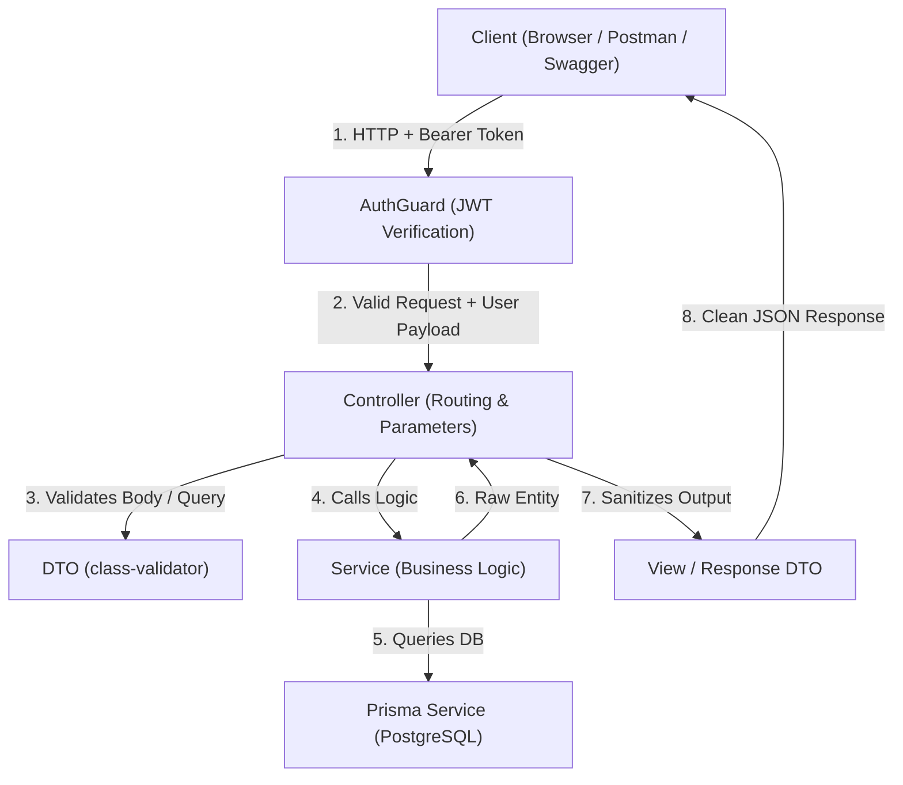
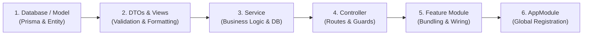

# Guide: How to Implement, Protect, and Extend Modules in TKPEX

This guide provides a step-by-step manual for working with modules in this project. It covers:
1. **Project Conventions & Architecture**
2. **The Coding Sequence: What to Build First (Inside-Out)**
3. **Anatomy of a Module: `AttendanceModule` Line-by-Line**
4. **How to protect any module or route using JWT `AuthGuard`**
5. **How to add a new endpoint/feature to an existing module**
6. **How to build a brand new module from scratch**
7. **Verification & Testing Checklist**
8. **Testing Endpoints via Swagger**

---

## 1. Project Conventions & Architecture

Every module in [`src/modules/`](file:///d:/Dev/TKPEX/src/modules) follows standard NestJS modular architecture and strict **ESM (NodeNext)** module resolution:



### Essential Rules
- **Import Extensions**: All local file imports **MUST** end with `.js` (e.g. `import { AuthService } from './services/auth.service.js';`).
- **Data Protection**: Never return raw database records containing passwords or internal fields directly. Always transform with a `ResponseDto`.
- **Validation**: Incoming request bodies and queries must be typed with DTOs using `class-validator` and `@ApiProperty`.

---

## 2. The Coding Sequence: What to Build First (Inside-Out)

When building a feature in NestJS (like Attendance), always code from the **inside out** (data layer → business logic → HTTP routing → module wiring). If you create the module first, TypeScript will report errors because the controller and service files do not exist yet.



### The 6-Step Build Order
1. **Model / Entity (`models/`)**: Define the data shape (`attendance.entity.ts`).
2. **DTOs & Views (`dto/`, `views/`)**: Define what comes into the API (`check-in.dto.ts`) and what sanitized JSON goes out (`attendance-response.dto.ts`).
3. **Service (`services/`)**: Implement business rules and database queries (`attendance.service.ts`). It doesn't care about HTTP status codes; it only processes data.
4. **Controller (`controllers/`)**: Expose routes (`@Get()`, `@Post('check-in')`), inject the service, and apply guards like `@UseGuards(AuthGuard)`.
5. **Feature Module (`attendance.module.ts`)**: Wire the controller and service together, import external modules (like `AuthModule`), and export the service.
6. **Root Registration (`app.module.ts`)**: Register the new module in `AppModule.imports` so NestJS starts it.

---

## 3. Anatomy of a Module: `AttendanceModule` Line-by-Line

Here is the complete [`src/modules/attendance/attendance.module.ts`](file:///d:/Dev/TKPEX/src/modules/attendance/attendance.module.ts):

```typescript
import { Module } from '@nestjs/common';
import { AttendanceController } from './controllers/attendance.controller.js';
import { AttendanceService } from './services/attendance.service.js';
import { AuthModule } from '../auth/auth.module.js';

@Module({
  imports: [AuthModule],
  controllers: [AttendanceController],
  providers: [AttendanceService],
  exports: [AttendanceService],
})
export class AttendanceModule {}
```

### Breakdown of the 4 `@Module` Properties

| Property | What it Does | Why it is Here in `AttendanceModule` |
| :--- | :--- | :--- |
| **`imports`** | Other modules whose exported providers this module needs. | `[AuthModule]` gives `AttendanceController` access to `AuthGuard` for verifying JWT tokens. |
| **`controllers`** | The API routes/endpoints this module exposes to the outside world. | `[AttendanceController]` registers HTTP routes like `GET /attendance` and `POST /attendance/check-in`. |
| **`providers`** | Classes that NestJS instantiates and injects (Dependency Injection). | `[AttendanceService]` creates the service instance so Nest can inject it into `AttendanceController`. |
| **`exports`** | Providers from this module that **other** modules can use. | `[AttendanceService]` allows another module (like `ReportsModule` or `UsersModule`) to inject and use `AttendanceService`. |

---

## 4. How to Add JWT Protection (`AuthGuard`) to Any Module

When an endpoint or entire controller requires the user to be logged in, apply the project's **`AuthGuard`**.

### Step 1: Import `AuthModule` in your Feature Module
Open your module file (e.g. [`src/modules/attendance/attendance.module.ts`](file:///d:/Dev/TKPEX/src/modules/attendance/attendance.module.ts)) and import `AuthModule`:

```typescript
import { Module } from '@nestjs/common';
import { AttendanceController } from './controllers/attendance.controller.js';
import { AttendanceService } from './services/attendance.service.js';
import { AuthModule } from '../auth/auth.module.js'; // <-- 1. Import AuthModule

@Module({
  imports: [AuthModule], // <-- 2. Add to imports array
  controllers: [AttendanceController],
  providers: [AttendanceService],
  exports: [AttendanceService],
})
export class AttendanceModule {}
```

### Step 2: Protect the Controller or Specific Routes
Open your controller (e.g. `attendance.controller.ts`) and decorate it:

#### Option A: Protect the entire controller (All routes require login)
```typescript
import { Controller, Get, UseGuards } from '@nestjs/common';
import { ApiBearerAuth, ApiTags } from '@nestjs/swagger';
import { AuthGuard } from '../../auth/guards/auth.guard.js';

@ApiTags('attendance')
@ApiBearerAuth()        // Displays lock icon in Swagger UI
@UseGuards(AuthGuard)   // Rejects requests without valid Bearer token
@Controller('attendance')
export class AttendanceController {
  // All methods inside are protected
}
```

#### Option B: Protect only a specific route
```typescript
@Get('public-info')
getPublicInfo() {
  return { status: 'open' };
}

@UseGuards(AuthGuard)
@ApiBearerAuth()
@Get('private-info')
getPrivateInfo() {
  return { status: 'confidential' };
}
```

### Step 3: Access the Logged-In User with `@CurrentUser()`
Use the custom parameter decorator [`@CurrentUser()`](file:///d:/Dev/TKPEX/src/modules/auth/decorators/current-user.decorator.ts) to read the user identity directly from the token:

```typescript
import { CurrentUser, type JwtPayload } from '../../auth/decorators/current-user.decorator.js';

@Get('my-records')
async getMyRecords(@CurrentUser() user: JwtPayload) {
  // user.sub   -> User ID (UUID)
  // user.email -> User Email
  // user.role  -> User Role ('admin' | 'user')
  return this.attendanceService.findAll(user.sub);
}
```

---

## 5. How to Add a New Feature to an Existing Module

Follow this 4-step sequence whenever you add a new endpoint or feature:

### Step 1: Create or Update the DTO (`dto/`)
Create a request validation class with `class-validator` and `@ApiProperty`:

```typescript
// src/modules/attendance/dto/filter-attendance.dto.ts
import { ApiPropertyOptional } from '@nestjs/swagger';
import { IsDateString, IsOptional, IsString } from 'class-validator';

export class FilterAttendanceDto {
  @ApiPropertyOptional({ example: '2026-10-28', description: 'Date in YYYY-MM-DD' })
  @IsOptional()
  @IsDateString()
  date?: string;

  @ApiPropertyOptional({ example: 'uuid-user-id' })
  @IsOptional()
  @IsString()
  userId?: string;
}
```

### Step 2: Add Business Logic in the Service (`services/`)
Inject `PrismaService` and perform database operations:

```typescript
// In attendance.service.ts
async findByDateRange(startDate: string, endDate: string) {
  return this.prisma.attendance.findMany({
    where: {
      date: {
        gte: startDate,
        lte: endDate,
      },
    },
    orderBy: { checkInTime: 'desc' },
  });
}
```

### Step 3: Transform Output with View DTO (`views/`)
Ensure sensitive internal fields are safely excluded:

```typescript
// In attendance-response.dto.ts
export class AttendanceResponseDto {
  id: string;
  userId: string;
  date: string;
  status: string;
  // Excludes any secret internal data
}
```

### Step 4: Expose Route in Controller (`controllers/`)
Add HTTP decorators (`@Get`, `@Post`, etc.) and Swagger documentation:

```typescript
@Get('range')
@ApiOperation({ summary: 'Find records within a date range' })
async getRange(
  @Query('start') start: string,
  @Query('end') end: string,
): Promise<AttendanceResponseDto[]> {
  const records = await this.attendanceService.findByDateRange(start, end);
  return AttendanceResponseDto.fromEntities(records);
}
```

---

## 6. How to Create a Brand New Module from Scratch

When creating a new feature module (for example, `schedules`), follow this checklist:

### Directory Structure to Create
```text
src/modules/schedules/
├── controllers/
│   └── schedules.controller.ts
├── dto/
│   ├── create-schedule.dto.ts
│   └── update-schedule.dto.ts
├── models/
│   └── schedule.entity.ts
├── services/
│   ├── schedules.service.ts
│   └── schedules.service.spec.ts
├── views/
│   └── schedule-response.dto.ts
└── schedules.module.ts
```

### Step-by-Step Implementation

1. **Verify Database Model**:
   Check [`prisma/schema.prisma`](file:///d:/Dev/TKPEX/prisma/schema.prisma) to see if the table exists. If you add or modify a model, run:
   ```bash
   npx prisma generate
   ```

2. **Create the Entity & View**:
   - `models/schedule.entity.ts`: TypeScript representation of the Prisma model.
   - `views/schedule-response.dto.ts`: Output DTO formatted for API responses.

3. **Create the Input DTOs**:
   - `dto/create-schedule.dto.ts`: Input validation with `@IsString()`, `@IsNotEmpty()`, `@ApiProperty()`.

4. **Create the Service**:
   ```typescript
   import { Injectable, NotFoundException } from '@nestjs/common';
   import { PrismaService } from '../../database/prisma/prisma.service.js';
   import { CreateScheduleDto } from '../dto/create-schedule.dto.js';

   @Injectable()
   export class SchedulesService {
     constructor(private readonly prisma: PrismaService) {}

     async findAll() {
       return this.prisma.schedule.findMany();
     }

     async create(dto: CreateScheduleDto) {
       return this.prisma.schedule.create({ data: dto });
     }
   }
   ```

5. **Create the Controller**:
   ```typescript
   import { Body, Controller, Get, Post, UseGuards } from '@nestjs/common';
   import { ApiBearerAuth, ApiTags } from '@nestjs/swagger';
   import { SchedulesService } from '../services/schedules.service.js';
   import { CreateScheduleDto } from '../dto/create-schedule.dto.js';
   import { AuthGuard } from '../auth/guards/auth.guard.js';

   @ApiTags('schedules')
   @ApiBearerAuth()
   @UseGuards(AuthGuard)
   @Controller('schedules')
   export class SchedulesController {
     constructor(private readonly schedulesService: SchedulesService) {}

     @Get()
     findAll() {
       return this.schedulesService.findAll();
     }

     @Post()
     create(@Body() dto: CreateScheduleDto) {
       return this.schedulesService.create(dto);
     }
   }
   ```

6. **Create the Module File**:
   ```typescript
   import { Module } from '@nestjs/common';
   import { SchedulesController } from './controllers/schedules.controller.js';
   import { SchedulesService } from './services/schedules.service.js';
   import { AuthModule } from '../auth/auth.module.js';

   @Module({
     imports: [AuthModule],
     controllers: [SchedulesController],
     providers: [SchedulesService],
     exports: [SchedulesService],
   })
   export class SchedulesModule {}
   ```

7. **Register in `AppModule`**:
   Open [`src/app.module.ts`](file:///d:/Dev/TKPEX/src/app.module.ts) and add `SchedulesModule` to the `imports` array:
   ```typescript
   import { SchedulesModule } from './modules/schedules/schedules.module.js';

   @Module({
     imports: [
       PrismaModule,
       UsersModule,
       AttendanceModule,
       AuthModule,
       SchedulesModule, // <-- Added here
       JwtModule.register({ ... }),
     ],
   })
   export class AppModule {}
   ```

---

## 7. Verification & Testing Checklist

Before finishing changes to any module, run these commands:

| Command | Purpose | Expected Output |
| :--- | :--- | :--- |
| `npx tsc --noEmit` | Validates TypeScript types and import extensions | Exits with `0` errors |
| `npm run lint` | Runs `oxlint` on `src/` and `test/` | `0 warnings and 0 errors` |
| `npm run test` | Runs all Vitest unit tests | All tests pass |
| `npm run test:e2e` | Runs Vitest E2E test suite | All E2E tests pass |

---

## 8. Testing Endpoints via Swagger

1. Start development server:
   ```bash
   npm run start:dev
   ```
2. Navigate to: `http://localhost:3000/api/docs`
3. Call `POST /auth/login` with your credentials to obtain an `accessToken`.
4. Click the green **Authorize** button at the top of Swagger UI.
5. Paste the token into the `bearer` field and click **Authorize**.
6. All protected routes in `attendance` (and other protected modules) can now be executed directly in the browser.
