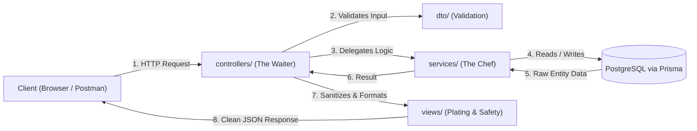

# Beginner's Guide to the Users Module & Modular MVC Architecture

Welcome! If you are new to **NestJS** and the **MVC (Model-View-Controller)** pattern, this guide explains every folder in [`src/modules/users/`](file:///d:/Dev/TKPEX/src/modules/users), what each file does, and the exact step-by-step sequence to build or understand any module.

---

## 1. The Big Picture: The Restaurant Analogy 🍽️

Understanding how the folders work together is much easier using a simple restaurant analogy:

| Folder / File | Role in Restaurant | Role in NestJS App |
| :--- | :--- | :--- |
| **`controllers/`** | **The Waiter** | Listens for client HTTP requests (GET, POST), hands work to the Service, and delivers the response back. |
| **`dto/`** | **The Order Ticket** | Validates the customer's order. Checks if required fields (name, email) are valid before touching the kitchen. |
| **`services/`** | **The Chef in the Kitchen** | Contains business rules and logic. Queries PostgreSQL via Prisma to fetch or store data. |
| **`models/`** | **The Recipe / Blueprint** | Defines what a "User" is (fields, data types) in TypeScript. |
| **`views/`** | **Plating & Presentation** | Prepares clean output for the customer. Strips out sensitive fields (like passwords) before sending to client. |
| **`users.module.ts`** | **The Kitchen Department** | Bundles the Waiter, Chef, and ingredients together so NestJS can run them. |



---

## 2. Detailed Breakdown of Every Folder in `users/`

### 1. `models/` — The Core Blueprint
- **File**: [`src/modules/users/models/user.entity.ts`](file:///d:/Dev/TKPEX/src/modules/users/models/user.entity.ts)
- **Purpose**: Defines the internal TypeScript shape of a `User`.
- **What it contains**:
  ```typescript
  export class User {
    id: string;
    name: string;
    email: string;
    role: string;
    createdAt: Date;
    updatedAt: Date;
  }
  ```
- **Why we need it**: It gives TypeScript full type safety so you never misspell property names across your application.

---

### 2. `dto/` — Data Transfer Objects (Input Validation)
- **Files**:
  - [`src/modules/users/dto/create-user.dto.ts`](file:///d:/Dev/TKPEX/src/modules/users/dto/create-user.dto.ts) (For new user registrations)
  - [`src/modules/users/dto/update-user.dto.ts`](file:///d:/Dev/TKPEX/src/modules/users/dto/update-user.dto.ts) (For editing existing users)
- **Purpose**: Checks and cleans incoming data from the user before your code processes it.
- **What it contains**:
  ```typescript
  import { IsEmail, IsNotEmpty, IsString, MinLength } from 'class-validator';

  export class CreateUserDto {
    @IsString()
    @IsNotEmpty()
    name: string;

    @IsEmail() // ⚠️ Automatically rejects invalid emails like "not-an-email"
    email: string;

    @IsString()
    @MinLength(6) // ⚠️ Automatically rejects passwords shorter than 6 characters
    password: string;
  }
  ```
- **Why we need it**: Security and data integrity. It prevents attackers or buggy clients from submitting malformed data.

---

### 3. `views/` — Response View Models (Safe Output)
- **File**: [`src/modules/users/views/user-response.dto.ts`](file:///d:/Dev/TKPEX/src/modules/users/views/user-response.dto.ts)
- **Purpose**: Formats and sanitizes the data sent back to the client.
- **What it contains**:
  ```typescript
  export class UserResponseDto {
    id: string;
    name: string;
    email: string;
    role: string;
    createdAt: string;

    // ⚠️ Notice: PASSWORD IS NEVER INCLUDED HERE!
  }
  ```
- **Why we need it**: **Security!** In your database, a user has a `password` hash. You should **never** send raw password hashes back in an HTTP response. The View model acts as a protective shield.

---

### 4. `services/` — Business Logic & Database Access
- **Files**:
  - [`src/modules/users/services/users.service.ts`](file:///d:/Dev/TKPEX/src/modules/users/services/users.service.ts) (Implementation)
  - [`src/modules/users/services/users.service.spec.ts`](file:///d:/Dev/TKPEX/src/modules/users/services/users.service.spec.ts) (Unit tests)
- **Purpose**: The "brain" of the feature. It interacts with Prisma and enforces business rules (e.g., checking if an email is already taken).
- **What it contains**:
  ```typescript
  @Injectable()
  export class UsersService {
    constructor(private readonly prisma: PrismaService) {}

    async findAll() {
      return this.prisma.user.findMany();
    }

    async create(dto: CreateUserDto) {
      // Check for duplicates
      const existing = await this.prisma.user.findUnique({ where: { email: dto.email } });
      if (existing) throw new ConflictException('Email already registered');
      
      return this.prisma.user.create({ data: dto });
    }
  }
  ```

---

### 5. `controllers/` — HTTP Routing & Endpoints
- **File**: [`src/modules/users/controllers/users.controller.ts`](file:///d:/Dev/TKPEX/src/modules/users/controllers/users.controller.ts)
- **Purpose**: Defines public HTTP endpoints and maps them to service methods.
- **What it contains**:
  ```typescript
  @Controller('users') // Base URL: /users
  export class UsersController {
    constructor(private readonly usersService: UsersService) {}

    @Get() // GET /users
    async findAll() {
      const users = await this.usersService.findAll();
      return UserResponseDto.fromEntities(users);
    }

    @Post() // POST /users
    async create(@Body() dto: CreateUserDto) {
      const user = await this.usersService.create(dto);
      return UserResponseDto.fromEntity(user);
    }
  }
  ```

---

### 6. `users.module.ts` — The Packaging Container
- **File**: [`src/modules/users/users.module.ts`](file:///d:/Dev/TKPEX/src/modules/users/users.module.ts)
- **Purpose**: Bundles the controller and service together into a self-contained NestJS module.
- **What it contains**:
  ```typescript
  @Module({
    controllers: [UsersController],
    providers: [UsersService],
    exports: [UsersService], // Allows other modules (like Auth or Attendance) to use UsersService
  })
  export class UsersModule {}
  ```

---

## 3. The Creation Sequence: How to Build a Module from Scratch

When creating a new feature module (like `attendance`, `products`, or `orders`), follow this exact **7-step creation order**:

```text
Step 1: models/         --> Define what data entities exist
Step 2: dto/            --> Define what input fields users can send (and validation rules)
Step 3: views/          --> Define what response fields are safe to send back
Step 4: services/       --> Write the database queries and business rules
Step 5: controllers/    --> Create HTTP routes (GET, POST, PATCH, DELETE)
Step 6: feature.module  --> Connect the Controller and Service inside the module
Step 7: app.module.ts   --> Register the feature module into the main application
```

### Why this sequence?
1. **You cannot write a Service** until you know what the **Model** and **DTOs** look like.
2. **You cannot write a Controller** until the **Service** and **View DTOs** are ready to be called.
3. **You cannot register the Module** until the Controller and Service classes exist.

---

## 4. Runtime Request Lifecycle: What Happens When a User Clicks "Submit"

Here is what happens inside NestJS when someone calls `POST /users`:

```text
1. Client sends:
   POST http://localhost:3000/users
   Body: { "name": "Diana", "email": "diana@example.com", "password": "pass" }

2. ValidationPipe intercepts:
   Checks CreateUserDto: Is password >= 6 chars?
   -> No! It is 4 chars ("pass").
   -> ValidationPipe IMMEDIATELY returns 400 Bad Request to client!
   (The Service and Database are never even touched, saving resources!)

3. If input is valid:
   Controller receives validated CreateUserDto.
   Controller calls: usersService.create(dto).

4. Service executes:
   Checks PostgreSQL: Does diana@example.com exist?
   If No -> Calls prisma.user.create(...).
   PostgreSQL inserts row and returns new user with ID & hashed password.

5. View Sanitization:
   Controller wraps user in UserResponseDto.fromEntity(user).
   Password hash is stripped out.

6. Response delivered:
   Client receives: 201 Created with { "id": "...", "name": "Diana", "email": "diana@example.com" }.
```

---

---

## 5. The Deep Purpose Behind the Architectural Rules

Beginners often ask: *"Why can't I just write everything in one file? What is the purpose of all these folders and rules?"*

Here is the exact **purpose** behind each rule, the **disaster that happens if you break it**, and the **real-world benefit**:

---

### Rule 1: Keep Controllers Lean (Controllers Only Delegate)

- **The Purpose**: **Separation of Concerns and Reusability.**
  The Controller's only job is handling the HTTP layer (reading URLs, headers, cookies, query parameters). The Service's job is business and database logic.
- **What happens if you break it (Anti-Pattern)**:
  If you write database queries directly inside `users.controller.ts`, your database code is trapped inside HTTP endpoints.
  - If you later want to build a **CLI command** (`pnpm run create-admin`), a **cron job**, a **WebSocket event**, or a **GraphQL API**, you would have to copy-paste the database code because you can't easily call an HTTP Controller from a background job.
- **The Benefit**:
  Your `UsersService` can be injected and reused anywhere: in other modules (like `AttendanceService` checking if a user exists), in background jobs, or in WebSocket gateways, without touching HTTP code.

---

### Rule 2: Never Return Database Entities Directly (The View Layer Purpose)

- **The Purpose**: **Data Privacy and Security Isolation.**
  Your database schema stores everything—including `password` hashes, internal audit flags, reset tokens, and payment customer IDs. The View layer (`UserResponseDto`) acts as an airlock that explicitly decides what travels over the internet.
- **What happens if you break it (Anti-Pattern)**:
  If you return raw database entities (`return this.prisma.user.findMany()`), anyone opening browser DevTools (Network tab) or inspecting API traffic will see the hashed passwords. If an attacker collects hashes, they can run offline dictionary attacks (e.g. Hashcat) to crack passwords.
- **The Benefit**:
  Even if someone adds sensitive columns (`ssn`, `twoFactorSecret`, `stripeCustomerId`) to PostgreSQL tomorrow, the API will **never leak them** because the View model only exposes properties explicitly listed in `UserResponseDto`.

---

### Rule 3: Always Validate Input with DTOs (`class-validator`)

- **The Purpose**: **Fail-Fast Data Integrity & Attack Prevention.**
  DTOs validate incoming user input at the very edge of the application before any server resources are consumed.
- **What happens if you break it (Anti-Pattern)**:
  - **Database Corruption**: A user registers with an empty email `""` or invalid role `"super_god_mode"`. Your database becomes filled with garbage data that breaks other services.
  - **Wasted Server Resources**: Invalid requests travel through your Controller, through your Service, establish a connection to PostgreSQL, and only then fail with an ugly database crash.
  - **Security Vulnerabilities**: Mass-assignment attacks (where an attacker sends extra fields like `"role": "admin"` in the request body to promote their own account).
- **The Benefit**:
  With `ValidationPipe` and `whitelist: true`, NestJS automatically strips away unexpected fields and rejects bad input in **0.1 milliseconds**, protecting your database from bad data.

---

### Rule 4: Always Use `async / await` for Database Queries

- **The Purpose**: **Preserving Node.js Non-Blocking Event Loop Performance.**
  Node.js runs on a single thread. When your code asks PostgreSQL for data, PostgreSQL has to read from disk over a network connection, which takes a few milliseconds.
- **What happens if you break it (Anti-Pattern)**:
  - If you don't `await` a database call, your controller returns an empty `Promise {}` before the database even responds, causing the frontend to get blank data or undefined crashes.
  - If database calls were synchronous (blocking), the **entire web server would freeze** for every single user worldwide while waiting for one person's database query to finish!
- **The Benefit**:
  While PostgreSQL processes user A's query asynchronously in the background, Node.js can serve 1,000 other users simultaneously without slowing down.

---

### Rule 5: Why Use Dependency Injection (DI) instead of `new UsersService()`?

- **The Purpose**: **Testability, Loose Coupling, and Memory Efficiency.**
  In traditional beginner code, classes create their own dependencies:
  ```typescript
  // ❌ Beginner Trap: Hardcoded creation
  const prisma = new PrismaClient();
  const userService = new UsersService(prisma);
  ```
  In NestJS, you simply declare it in the constructor:
  ```typescript
  // ✅ NestJS Best Practice: Injected by Framework
  constructor(private readonly usersService: UsersService) {}
  ```
- **What happens if you break it**:
  - Every time an HTTP request arrives, creating `new PrismaClient()` creates a new database connection pool. Your PostgreSQL server will run out of connection limits within minutes and crash!
  - It becomes impossible to write unit tests because you can't replace the real database with a mock database.
- **The Benefit**:
  NestJS creates **one single instance** (Singleton) of `PrismaService` and shares it across all modules, saving memory and connection pools, while allowing unit tests to easily substitute mock providers.

---

## 6. Summary Reference Table

| Pattern / Component | Purpose in Architecture | Danger if Ignored |
| :--- | :--- | :--- |
| **`controllers/`** | HTTP transport layer only | Business logic cannot be reused by cron jobs or other modules |
| **`dto/`** | Edge input validation | Malformed or malicious data enters the database |
| **`services/`** | Pure business & database logic | Tightly couples logic to web framework |
| **`views/`** | Sanitized output formatting | Accidental leaks of password hashes or sensitive fields |
| **`Dependency Injection`** | Injects singletons automatically | Excessive memory usage & database connection exhaustion |
| **`async / await`** | Non-blocking event loop execution | Unhandled promise rejections or freezing the server |

