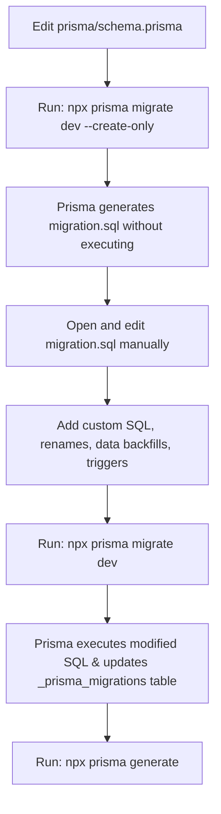

# Prisma Manual Migration Guide & Practical Scenarios

This guide details how to perform **manual and custom migrations in Prisma ORM**, manage raw SQL, prevent data loss during schema refactoring, baseline an existing database, and deploy migrations safely.

---

## Quick Reference Commands

| Goal | Command |
| :--- | :--- |
| **Draft migration without applying** | `npx prisma migrate dev --create-only --name <name>` |
| **Apply pending migrations (Dev)** | `npx prisma migrate dev` |
| **Generate migration from schema diff** | `npx prisma migrate diff --from-empty --to-schema-datamodel prisma/schema.prisma --script > migration.sql` |
| **Mark migration as applied (Baselining)** | `npx prisma migrate resolve --applied <migration_directory_name>` |
| **Mark failed migration as rolled back** | `npx prisma migrate resolve --rolled-back <migration_directory_name>` |
| **Deploy migrations in Production / CI** | `npx prisma migrate deploy` |
| **Check migration status / drift** | `npx prisma migrate status` |

---

## 1. Why and When to Use Manual Migrations?

By default, `npx prisma migrate dev` compares your `schema.prisma` against your database, auto-generates SQL, and executes it immediately.

However, auto-generation is **dangerous or insufficient** when:
1. **Renaming a Column or Table**: Prisma doesn't know you renamed a column—it generates a `DROP COLUMN` (destroying data) followed by an `ADD COLUMN`.
2. **Adding a `NOT NULL` Column**: Adding a non-nullable column to a table that already has rows will fail unless you backfill default values first.
3. **Advanced Database Features**: Views, partial indexes, triggers, stored procedures, or PostgreSQL extensions (`pgcrypto`, `citext`).
4. **Data Migrations**: Splitting one column into two (e.g., `fullName` -> `firstName` + `lastName`).



---

## 2. Realistic Practical Scenarios

### Scenario A: Safely Renaming a Column Without Data Loss

> **Problem**: You want to rename the `notes` column in the `attendances` table to `remarks`.
> If you just change `notes` to `remarks` in `schema.prisma` and run `prisma migrate dev`, Prisma will drop `notes` (deleting all existing notes!) and create an empty `remarks` column.

#### Step 1: Update `schema.prisma`
In `prisma/schema.prisma`:
```prisma
model Attendance {
  id           String    @id @default(uuid())
  userId       String
  date         String
  checkInTime  DateTime  @default(now())
  checkOutTime DateTime?
  status       String    @default("present")
  remarks      String?   // <-- Renamed from notes
  createdAt    DateTime  @default(now())
  updatedAt    DateTime  @updatedAt

  @@map("attendances")
}
```

#### Step 2: Create the migration draft without executing
```powershell
npx prisma migrate dev --create-only --name rename_notes_to_remarks
```
Prisma creates a new folder: `prisma/migrations/<timestamp>_rename_notes_to_remarks/migration.sql`.

#### Step 3: Inspect the generated `migration.sql`
Prisma's generated SQL will look like this:
```sql
-- DANGEROUS DEFAULT:
ALTER TABLE "attendances" DROP COLUMN "notes";
ALTER TABLE "attendances" ADD COLUMN "remarks" TEXT;
```

#### Step 4: Manually edit `migration.sql`
Replace the drop & add with PostgreSQL's safe rename command:
```sql
-- SAFE MANUAL FIX:
ALTER TABLE "attendances" RENAME COLUMN "notes" TO "remarks";
```

#### Step 5: Apply the modified migration
```powershell
npx prisma migrate dev
```
Prisma executes your modified SQL script, preserves existing data, records the migration in `_prisma_migrations`, and updates Prisma Client.

---

### Scenario B: Adding a Non-Nullable Column with Data Backfill

> **Problem**: You want to add a required `department` column to `users`, but you already have users in production. Adding `department String` without default will fail with `column contains null values`.

#### Step 1: Update `schema.prisma`
```prisma
model User {
  id         String   @id @default(uuid())
  name       String
  email      String   @unique
  department String   // Non-nullable, no default
  ...
}
```

#### Step 2: Generate draft migration
```powershell
npx prisma migrate dev --create-only --name add_user_department
```

#### Step 3: Edit `migration.sql` to execute in 3 safe steps
```sql
-- 1. Add column as NULLABLE first
ALTER TABLE "users" ADD COLUMN "department" TEXT;

-- 2. Backfill existing rows with appropriate value
UPDATE "users" SET "department" = 'General' WHERE "department" IS NULL;

-- 3. Alter column to NOT NULL
ALTER TABLE "users" ALTER COLUMN "department" SET NOT NULL;
```

#### Step 4: Apply migration
```powershell
npx prisma migrate dev
```

---

### Scenario C: Adding Custom PostgreSQL Triggers / Views (Raw SQL Only)

> **Scenario**: You want to create a custom reporting view or PostgreSQL trigger without modifying Prisma models.

#### Step 1: Create an empty migration draft
Without making changes to `schema.prisma`, run:
```powershell
npx prisma migrate dev --create-only --name add_attendance_summary_view
```

#### Step 2: Write raw PostgreSQL in `migration.sql`
Open the generated `migration.sql` and add:
```sql
CREATE OR REPLACE VIEW attendance_monthly_report AS
SELECT 
  "userId",
  COUNT(*) as total_days,
  COUNT(*) FILTER (WHERE status = 'present') as present_days,
  COUNT(*) FILTER (WHERE status = 'late') as late_days
FROM "attendances"
GROUP BY "userId";
```

#### Step 3: Apply the migration
```powershell
npx prisma migrate dev
```

---

### Scenario D: Baselining an Existing Database

> [!IMPORTANT]
> When a database already has tables created (such as when using `prisma db push` or pre-existing legacy tables), running `prisma migrate dev` will ask to reset the database and delete all data. **Baselining prevents this.**

#### Step 1: Create the baseline migration directory
```powershell
mkdir prisma/migrations/0_init
```

#### Step 2: Generate SQL representing the current state
```powershell
npx prisma migrate diff --from-empty --to-schema-datamodel prisma/schema.prisma --script > prisma/migrations/0_init/migration.sql
```

#### Step 3: Mark the migration as applied (without re-executing on existing tables)
```powershell
npx prisma migrate resolve --applied 0_init
```

Now, Prisma marks `0_init` as already executed in `_prisma_migrations`. All future migrations can use normal `prisma migrate dev`.

---

## 3. Real Project Walkthrough: Adding User Schedules (`schedules`)

Here is the exact step-by-step process we used in this project (`TKPEX`) on local PostgreSQL to migrate and seed the database.

### Step 1: Baseline the Existing Database
Because the database already had `users` and `attendances` tables created, running migration directly would prompt a destructive database reset. We baselined it first:

```powershell
# 1. Create baseline folder
mkdir prisma/migrations/0_init

# 2. Extract schema into SQL (UTF-8 without BOM)
npx prisma migrate diff --from-empty --to-schema-datamodel prisma/schema.prisma --script > prisma/migrations/0_init/migration.sql

# 3. Mark 0_init as already executed in PostgreSQL
npx prisma migrate resolve --applied 0_init
```

### Step 2: Add Model to `prisma/schema.prisma`
We added the new `Schedule` model linked to `User`:

```prisma
model Schedule {
  id        String   @id @default(uuid())
  userId    String
  user      User     @relation(fields: [userId], references: [id], onDelete: Cascade)
  dayOfWeek Int      // 1 = Monday ... 7 = Sunday
  startTime String   // e.g. "08:00"
  endTime   String   // e.g. "16:00"
  shiftName String?  // e.g. "Morning Shift"
  isActive  Boolean  @default(true)
  createdAt DateTime @default(now())
  updatedAt DateTime @updatedAt

  @@map("schedules")
}
```

### Step 3: Generate the Migration
We executed:
```powershell
npx prisma migrate dev --name add_schedules_per_user
```

**What Prisma did automatically:**
1. Created `prisma/migrations/20261027141438_add_schedules_per_user/migration.sql`.
2. Executed the DDL in PostgreSQL:
   ```sql
   CREATE TABLE "schedules" (
       "id" TEXT NOT NULL,
       "userId" TEXT NOT NULL,
       "dayOfWeek" INTEGER NOT NULL,
       "startTime" TEXT NOT NULL,
       "endTime" TEXT NOT NULL,
       "shiftName" TEXT,
       "isActive" BOOLEAN NOT NULL DEFAULT true,
       "createdAt" TIMESTAMP(3) NOT NULL DEFAULT CURRENT_TIMESTAMP,
       "updatedAt" TIMESTAMP(3) NOT NULL,
       CONSTRAINT "schedules_pkey" PRIMARY KEY ("id")
   );
   ALTER TABLE "schedules" ADD CONSTRAINT "schedules_userId_fkey" 
     FOREIGN KEY ("userId") REFERENCES "users"("id") ON DELETE CASCADE ON UPDATE CASCADE;
   ```
3. Inserted a tracking record into the `_prisma_migrations` table.
4. Regenerated `@prisma/client` with full TypeScript definitions for `prisma.schedule`.

### Step 4: Seed Sample Data
We created [`prisma/seed.js`](file:///d:/Dev/TKPEX/prisma/seed.js) and ran:
```powershell
npx prisma db seed
```
This inserted 3 users (Alice, Bob, Charlie), 15 schedules (5 workdays each), and 5 attendance records into PostgreSQL.

### Step 5: Exact Live Database State in PostgreSQL (`tkpex`)

Here is the exact live data currently stored in your local PostgreSQL instance (`localhost:5432 / tkpex`):

#### 1. Applied Migrations (`_prisma_migrations` table)
| id | migration_name | finished_at | status |
| :--- | :--- | :--- | :--- |
| `298e1630-bd62-4f6e-ae2e-b39160b8a9b9` | `0_init` | `2026-10-27 14:14:29` | Applied (Baseline) |
| `039122ea-a74a-4fba-9caf-6623a6456370` | `20261027141438_add_schedules_per_user` | `2026-10-27 14:14:38` | Applied (Migration) |

#### 2. Users Table (`users`)
| id | name | email | role |
| :--- | :--- | :--- | :--- |
| `a9515136-7466-4a2b-89bd-a6fddd548a2f` | Alice Johnson | alice@example.com | admin |
| `0c0aec29-0d55-45a0-afae-f09e9e4ec2e1` | Bob Smith | bob@example.com | user |
| `157c4b66-e2e2-4c1c-898a-c819a69b5db3` | Charlie Davis | charlie@example.com | user |

#### 3. Schedules Table (`schedules` - sample rows)
| id | userId | dayOfWeek | shiftName | startTime | endTime | isActive |
| :--- | :--- | :--- | :--- | :--- | :--- | :--- |
| `a558f658-0bc2-4c20-814d-2492840c881d` | `0c0aec29...` (Bob) | 1 (Mon) | Standard Shift | 09:00 | 17:00 | true |
| `3aa1004b-9975-4dfe-9e8f-0ef2ad574e3d` | `0c0aec29...` (Bob) | 2 (Tue) | Standard Shift | 09:00 | 17:00 | true |
| `2312f13c-7340-412a-ba03-4c012f61c705` | `0c0aec29...` (Bob) | 3 (Wed) | Standard Shift | 09:00 | 17:00 | true |
| `7174740f-d6c8-4aa6-a247-6204013b8afa` | `157c4b66...` (Charlie) | 1 (Mon) | Evening Shift | 13:00 | 21:00 | true |
| *(+11 more rows)* | *(Alice, Bob, Charlie)* | 1 to 5 (Mon-Fri) | Morning / Standard / Evening | *(per shift)* | *(per shift)* | true |

#### 4. Attendances Table (`attendances`)
| id | userId | date | checkInTime | checkOutTime | status | notes |
| :--- | :--- | :--- | :--- | :--- | :--- | :--- |
| `6bf0655e-bbf3-4989-b514-edb869a2a0b1` | Bob Smith | 2026-10-27 | 08:50:00 | *null* | present | Checked in today |
| `420e3927-1be3-4448-b8f7-6194d29a9d24` | Alice Johnson | 2026-10-27 | 08:00:00 | *null* | present | Checked in today |
| `aa7ed77d-5106-414f-a1cf-1d954d2721bf` | Bob Smith | 2026-10-26 | 09:22:00 | 17:15:00 | late | Subway signal delay |
| `431ebe67-cc3f-4a7e-a093-992d56be653a` | Charlie Davis | 2026-10-26 | 12:55:00 | 21:02:00 | present | On schedule |
| `25ac1455-f7d9-4d9b-8a61-026087b07e3d` | Alice Johnson | 2026-10-26 | 07:58:00 | 16:05:00 | present | Arrived early for team sync |

---

### Step 6: Sample SQL Queries to Run in Navicat

You can open a Query tab in Navicat connected to **`tkpex`** and test these queries directly:

```sql
-- 1. View all users with their assigned weekly work shifts
SELECT 
  u.name, 
  u.email, 
  s."dayOfWeek", 
  s."shiftName", 
  s."startTime", 
  s."endTime"
FROM users u
JOIN schedules s ON u.id = s."userId"
ORDER BY u.name, s."dayOfWeek";

-- 2. Compare actual check-in against scheduled shift start time
SELECT 
  u.name,
  a.date,
  TO_CHAR(a."checkInTime", 'HH24:MI') as actual_checkin,
  s."startTime" as scheduled_start,
  a.status,
  a.notes
FROM attendances a
JOIN users u ON a."userId" = u.id
LEFT JOIN schedules s ON s."userId" = u.id 
  AND s."dayOfWeek" = EXTRACT(ISODOW FROM a."checkInTime"::date)
ORDER BY a.date DESC, u.name;

-- 3. Inspect Prisma migration execution history
SELECT migration_name, finished_at, applied_steps_count 
FROM "_prisma_migrations"
ORDER BY finished_at ASC;
```

---

## 4. How Manual Migration Execution Works Internally

Understanding Prisma's internal mechanism helps avoid common pitfalls:

### 1. The `_prisma_migrations` Table
Prisma creates an internal table in your PostgreSQL `public` schema:
```sql
SELECT id, checksum, finished_at, migration_name, applied_steps_count 
FROM "_prisma_migrations";
```
- **Checksum**: A SHA-256 hash of `migration.sql`. If you modify a migration file after it has already run, Prisma will detect a checksum mismatch and alert you to avoid database drift.
- **Finished At**: Null while running; filled with a timestamp upon successful completion.

### 2. Manual Execution via Navicat / psql
If your team does not allow CLI migration tools to run directly against production:
1. Generate the raw SQL script without connecting to production:
   ```powershell
   npx prisma migrate diff --from-schema-datamodel prisma/schema.prisma --to-schema-datasource prisma/schema.prisma --script > deploy.sql
   ```
2. Open `deploy.sql` in Navicat or your database administration tool.
3. Review and execute the script inside a SQL transaction:
   ```sql
   BEGIN;
   -- your migration queries here
   COMMIT;
   ```
4. Record the migration in Prisma so future CLI migrations know it has been executed:
   ```powershell
   npx prisma migrate resolve --applied <migration_name>
   ```

### 3. Production Deployment
In CI/CD or production containers, **never run `prisma migrate dev`**. Instead, run:
```powershell
npx prisma migrate deploy
```
- `prisma migrate deploy` never creates a shadow database.
- It never prompts to reset tables.
- It simply applies all unapplied migration files in chronological order.

---

## 5. Best Practices Checklist

> [!TIP]
> Follow these rules from `nestjs-best-practices` when working with Prisma migrations:

1. **Never use `db push` in production**: `db push` is meant for rapid prototyping; it does not track migration history and can drop tables silently.
2. **Always review `--create-only` SQL**: Before executing, verify whether any unexpected `DROP COLUMN` or `DROP TABLE` statements exist.
3. **Avoid UTF-8 BOM in SQL files**: Ensure migration files are standard UTF-8 (without Byte Order Mark), as PostgreSQL's parser treats `\uFEFF` as a syntax error.
4. **Commit `prisma/migrations` to Git**: Every developer and deployment pipeline needs the exact same migration files.
5. **Use `prisma migrate deploy` in CI/CD / Production**: This command is non-interactive and applies only unapplied migrations.
6. **Verify migration status anytime**:
   ```powershell
   npx prisma migrate status
   ```
